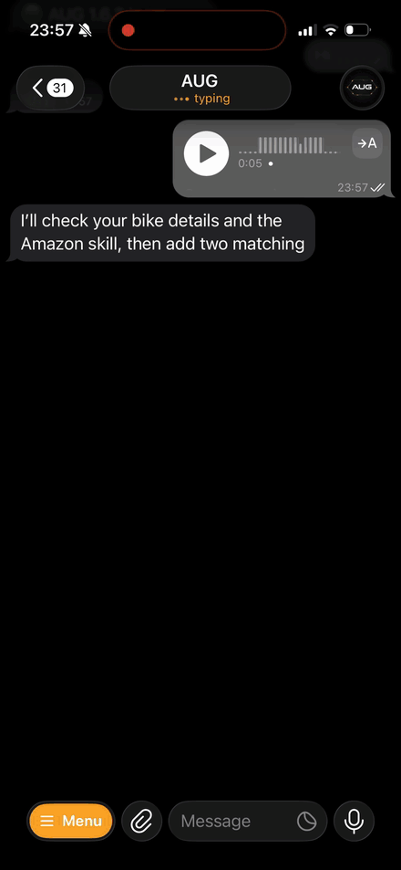

<table>
  <tr>
    <td>

# AUG

Your own assistant, built on Claude Code or Codex, with your current Claude or ChatGPT plan.

Talk to it in Telegram. It remembers you, keeps your schedule, messages you first and does real work on a Linux machine of its own.

  </td>
    <td></td>
  </tr>
</table>

```bash
curl -fsSL https://raw.githubusercontent.com/vadimtitov/aug/main/install.sh | bash
```

Runs in Docker on your Mac or a Linux server. [Read the script first](install.sh) · [Other ways to install](docs/installation.md)

## Why

Claude Code and Codex are excellent agent harnesses, and they come with your subscription, along with top-tier models. But they're built for code. AUG turns the same harness into a personal assistant.

## What it does

| | |
|---|---|
| **Chat** | Text, voice notes, photos, files, locations. Forum topics for parallel threads. |
| **Remember** | Takes notes as you talk and rewrites them every night into Markdown files you can read and edit. |
| **Schedule** | "Every Monday at 8, summarise my unread email." It runs the task and reports back. |
| **Work** | A Linux shell with Python and the usual tools. Send it a PDF, get a spreadsheet back. |
| **Browse** | Web search, and a page reader that gets past bot protection. |
| **Email** | Gmail, several accounts: search, read, draft, send. |
| **Your servers** | SSH, with your approval for every command. Docker through Portainer. |
| **Your home** | Home Assistant: "lights off" switches them before it even replies. |
| **Grow** | Writes its own skills. Installs MCP servers when you ask. |
| **Secrets** | API keys it can use but never see. |

## Agents

Pick one per chat with `/version`. Memory, skills and files are shared.

| Harness | Model | Runs on |
|---|---|---|
| Claude Code (default) | Claude Opus 5.5 | your Claude plan |
| Codex | GPT-6.1 Sol | your ChatGPT plan |
| LangGraph | Kimi K3, GLM-5.3 | per token |

Claude Code and Codex keep their own tools, subagents, compaction and web search. AUG adds the memory, the schedule, the chat and its tools. [More →](docs/agents.md)

## Cost

Nothing beyond your plan. AUG runs the official Claude Code and Codex, signed in as you. `/status` shows where you stand on your plan's limits.

Optional: an OpenAI key for voice notes and images. Kimi and GLM bill per token.

The vendors set their plans' terms, and the terms change. AUG is built for one person's own use.

## Safety

It works without asking, inside a container of its own that sees only its data folder. Your keys are masked in everything it reads. Commands on your other machines wait for your OK in Telegram. [Security →](docs/security.md)

## Compared with

- **Claude Code Remote Control, Codex cloud.** A coding session on your phone. AUG is an assistant: it remembers you, keeps a schedule and writes first.
- **OpenClaw.** Broader, and more to set up. On Claude it runs on an API key, billed per token. AUG stays on your plan.
- **The ChatGPT and Claude apps.** Their memory lives in the vendor's cloud. AUG runs on your machine, reaches your network and keeps its memory in your files.

## Next

Telegram today. Interfaces are pluggable: WhatsApp or a native iOS app is next.

---

[Installation](docs/installation.md) · [Agents](docs/agents.md) · [Using AUG](docs/usage.md) · [Configuration](docs/configuration.md) · [Security](docs/security.md) · MIT
