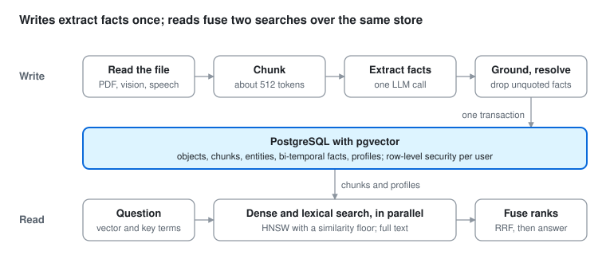
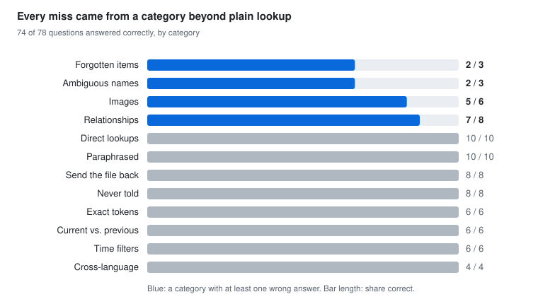

# A Knowledge Base for a Personal AI Assistant

*Design and evaluation · October 2026*

## Summary

This is the long-term memory of a personal AI assistant. One store keeps any information a person shares (facts, files, photos, voice notes) and answers questions about it months later. When asked, it can also send back the original file. It combines a hybrid search index over the raw text with a small fact graph that records time.

An end-to-end evaluation sent the live assistant 52 realistic messages, spread over seven simulated months, then asked 78 questions in fresh conversations. It answered 74 of 78 correctly (95%) and never invented an answer to something it had not been told. Every failure, in writing or in answering, was traced to a root cause. All but one are fixed.

One database holds both the text and the facts. A write extracts facts once and commits them in a single transaction. A read fuses two searches over the same chunks.

## Problem

A chat assistant forgets everything once a conversation ends. People still hand it things they expect it to keep: a phone number, a tenancy agreement, a photo of a whiteboard, a passing remark that a friend moved city. Weeks later they ask, in their own words and often in another language, and expect a precise answer or an honest "I don't know".

The store makes no assumptions about content. No domain schema exists: it has to work for *any* piece of information. It also had to meet five requirements:

- **Exact recall.** Identifiers such as a booking code, a licence plate or a port number must come back verbatim. Paraphrased questions must still find them. Files must come back too: "send me the tenancy agreement" returns the original PDF, not a summary of it.
- **Time awareness.** When a value changes, the old one becomes history, never a second current answer. "Where does John live now" and "where did he live before" are different questions.
- **No invention.** Saying "not on file" is always better than a confident guess.
- **Real forgetting.** When asked to forget something, it must stop resurfacing, including from text that merely mentioned it.
- **Isolation.** Every user's data is invisible to every other user, enforced by the database rather than by application code.

## Data model

The design treats text as the record and the graph as an index over it. Everything said or sent is kept verbatim and searchable. Structured facts are extracted on top as a precision layer, never as a replacement. If extraction misses a fact, the fact can still be found in the text.

| Element | What it is | Why it exists |
| --- | --- | --- |
| Object | One thing that was shared: a note, a PDF, an image, a voice message. Content-addressed by SHA-256, with the original bytes kept. | The source of truth. Duplicates collapse, and the file itself can be sent back. |
| Chunk | About 512 tokens of an object's text, with a one-line context written by the extractor. Each chunk carries a 1536-dimension embedding and a full-text vector. | The unit of search. |
| Entity | A person, place, organisation or any other thing, with aliases. | Lets "Lena", "my partner" and "Lena Orlova" become one node. |
| Fact | Subject, predicate, value (literal or entity). Each fact keeps its source quote and its validity interval. | Precise, time-aware answers. |
| Profile | A generated text summarising an entity's current facts, embedded like a chunk. | Makes entities findable by ordinary search. |

All of it lives in one PostgreSQL database with pgvector. That gives an HNSW index for vectors, a GIN index for full-text search and trigram matching for names. A single database means one write is one transaction: an object, its chunks, its facts and the profiles it changed land together or not at all.

Isolation is enforced by forced row-level security on every table. Each request runs under a restricted role, scoped to one owner. A test confirms that even a superuser connection sees nothing outside its scope.

Predicates are not a fixed vocabulary. The extractor proposes names freely, and those names are normalised lexically. `phone` and `phone_number` merge, and so do `home_address` and `address_home`. `gross_pay` and `net_pay` deliberately do not, since they differ in meaning, not just wording. An earlier design merged predicates by embedding similarity. It conflated exactly such near-synonyms, and was removed.

## Writing

The assistant saves through one tool call. It passes a self-contained statement, a file path, or both. Everything after that happens inside the store:

1. **Read.** The store pulls text from the file. Text-layer PDFs are parsed directly. Scanned pages and images go to a vision model that transcribes them. Audio goes to a speech-to-text model. Unreadable formats are still stored and stay findable by filename and accompanying note.
2. **Chunk.** Text is split into overlapping windows of about 512 tokens, cut on paragraph or sentence boundaries.
3. **Extract.** One structured LLM call returns:
   - a title, a summary and the date the content refers to
   - a context line for each chunk
   - entities and facts

   The call sees the entities and predicates already known, so it can reuse them instead of minting duplicates.
4. **Ground.** Any fact whose quote or value does not literally appear in the source is dropped. The extractor is told never to infer, and this check enforces it.
5. **Resolve.** Each entity is matched to an existing one, in order: by exact name, then by name-token containment within the same type, then by trigram similarity. If more than one candidate fits, the fact is held back and the assistant is told to ask which was meant.
6. **Commit.** One transaction writes the object, entities, facts, mentions and rebuilt profiles. Chunk embeddings are computed concurrently, so their network round trip overlaps the profile embedding's.

The tool returns what it saved, in plain words, plus one of three statuses: *ok*, *failed* or *unsupported*. A failure is always stated as "nothing was saved", never softened, because the assistant relays the result to the person as-is. Every write logs how long each stage took.

Model choice is configuration, not code. The extraction and vision models can be picked from a settings screen and take effect on the next write. The embedding model is fixed on purpose, because vectors from different models cannot be compared. Changing it would mean re-embedding everything.

## Reading

Search is hybrid. The query runs through two retrievers over the same chunks, profiles included. Their rankings are then fused with reciprocal rank fusion (k = 60):

- **Dense:** cosine similarity on embeddings, with a floor of 0.45. Below the floor a match is treated as noise, so a question about something never stored returns nothing rather than a weak, confident-looking hit.
- **Lexical:** full-text search over the question's distinctive words. The search uses a language-neutral configuration, so tokens like `KX7Q2P` or `atlas-stg` match exactly in any language.

The two cover each other's blind spots. Dense retrieval finds "where does my sister live" from "Katya moved to Vienna". Lexical retrieval finds a policy number that has no meaning to an embedding.

Optional filters run inside the search, not after it:

- **Fact:** "has a current `phone`".
- **Kind:** only images, only documents.
- **Source:** where the item came from.
- **Date:** two clocks. One is when the item was received; the other is the date it refers to, such as an invoice date.

Each hit returns a snippet. A second tool fetches a node in full: an object's text, or an entity's current facts with their history. It can also reconstruct the facts as they stood on a past date. For a stored file it returns the path to the original bytes, which the assistant sends back as an attachment. In the chat, that looks like "send me my September payslip" followed by the PDF itself.

The assistant is instructed to search before answering anything that might have been shared, to retry once with different words if the first search misses, and to answer "not on file" rather than guess. If a name matches two people, it must ask which one was meant. Per-turn caps on tool calls stop a confused model from looping.

## Time and forgetting

Facts are bi-temporal. Each fact records when it became true and when it stopped being true. Separately, the source object records when the information arrived. A predicate is either single-valued (one home address) or multi-valued (many cities visited). Asserting a new value for a single-valued predicate closes the old fact and links it to its successor. Nothing is overwritten, so "now" and "before" are both answerable from the same rows.

The extractor also marks facts that the text itself states are no longer true, such as "my *previous* car was a Golf". Those close an existing value instead of becoming the current one. Restating a value that already holds is a no-op.

Forgetting is a soft delete with consequences that go past the node itself. Deleting an object hides its facts, and also any entities that only it mentioned. Forgetting an entity is harder, because the entity also lives on in the text of every note that named it. A hidden graph node is useless if a full-text hit on that note brings the address straight back. So the store also:

1. Collects every spelling of the entity: names, aliases, distinctive parts of names, distinctive literal values and the quotes its facts came from.
2. Replaces those spellings in the mentioning objects with a `[forgotten]` marker, matching whole words only.
3. Re-embeds the chunks that changed, so the vector index forgets too.

Generic values such as "London" or "100" are left alone, since in a mentioning text they are often about something else.

## Evaluation

The evaluation tests the whole system, not the store alone. A harness drives the deployed assistant through its public chat API, exactly as a person would. It plays one invented persona: a 34-year-old in London who speaks English and Russian, with a partner, a baby daughter and a sister abroad. Every name, number and document is fictional.

**Writes.** The harness sends 52 events, each in a new conversation, dated from April to October 2026. After each event it moves the stored data back to that event's date. That way "last month" and "before she moved" mean what they would in real life. The events cover:

| Kind | Events | What it probes |
| --- | --- | --- |
| Plain facts | 14 | Phone numbers, codes, addresses, recipes |
| Passing mentions | 7 | Facts buried in chat about something else |
| Text PDFs | 6 | Tenancy agreement, payslips, tickets, invoices |
| Small talk | 6 | Must *not* be saved |
| Updates | 5 | A new address, car or password replacing the old one |
| Images | 5 | Boarding pass, whiteboard, receipt |
| Russian | 3 | Facts stated in another language |
| Scanned PDFs | 2 | Slightly rotated, noisy image-only pages |
| Ambiguous | 2 | "Anna" when two Annas are known |
| Forget requests | 2 | An item and an entity to erase |

After each write, the harness checks the database directly. The expected facts must be current, superseded values must be closed, the expected text must be stored, and forgotten strings must be gone.

**Questions.** Next it asks 78 questions, each in a new conversation, so nothing can come from short-term chat context. They cover 12 categories, from direct lookups to questions about things never mentioned. Each answer is graded twice:

- **By code:** did the assistant search, did the evidence appear in what the store returned, are the required strings present and the forbidden ones absent, and was the right file sent back.
- **By an LLM judge:** run on a different model family from the one under test, against the ground truth. It labels each answer *correct*, *partial*, *wrong* or *made up*.

Each failure is then classified automatically. A *search miss* means the evidence was in the store but the search did not return it. *Extraction* means it was never captured. *Leaked* means forgotten content resurfaced. *Agent misread* means the evidence was returned but the answer still went wrong. That makes every failure point at one layer.

The pass bar was fixed before the first run:

- zero invented answers
- zero forgotten items resurfacing
- 100% on direct and exact-token lookups
- at least 90% overall
- search p95 under 1 s

The harness and dataset live in [`eval/kb/`](../../eval/kb/).

## Results

The system met seven of the nine pass-bar targets on the full run. It gave zero invented answers and found 100% of direct and exact-token lookups. One forgotten item resurfaced, and text-only writes ran over their latency target.

Every category of plain lookup scored perfectly, including the eight questions about things never said, where the right answer is "not on file". The four misses fall in four categories that each need more than retrieval: erasure, disambiguation, reading a photo, and connecting two facts.

| Measure | Result | Target | Met |
| --- | --- | --- | --- |
| Invented answers to never-told questions | 0 | 0 | yes |
| Forgotten items resurfacing | 1 | 0 | no |
| Direct and exact-token questions | 16 / 16 | 100% | yes |
| All questions | 74 / 78 (95%) | ≥ 90% | yes |
| Searched when the question needed it | 75 / 75 | ≥ 95% | yes |
| Evidence present in what search returned | 76 / 78 | ≥ 90% | yes |
| Small talk wrongly saved | 0 / 6 | ≤ 1 / 6 | yes |
| Search latency, p95 | 480 ms | < 1 s | yes |
| Text-only write latency, p95 | 6.4 s | < 5 s | no |

47 of 52 write events passed every check. A write that carries a file took 9.8 s at the median and 15.3 s at p95, mostly in reading the file and in the extraction call. The timing logs added since then break that cost down by stage.

## Failure analysis

Of the nine failures, four came from bugs in the harness itself (three causes). Four came from three real defects, all now fixed. One remains open.

| Failure | Layer | Root cause | Change |
| --- | --- | --- | --- |
| A payslip write looped until the 300 s timeout | Store | Predicates were merged by embedding similarity, so `net_pay` overwrote `gross_pay`. The model kept "correcting" it, and each correction undid the other. | Lexical predicate normalisation; a per-turn cap on tool calls |
| A forgotten address came back in an answer (one write and one question) | Store | The entity was hidden, but the note that first mentioned it still held the address in its text. | Forgetting an entity now scrubs every spelling of it from mentioning text and re-embeds those chunks |
| A dentist appointment mentioned in passing was not saved | Agent | The assistant set a reminder and wrote a private note, and assumed that was enough. | The instructions now state that only the store is searchable later |
| An answer cited the wrong date for an event | Harness | Backdating changed timestamps but not the dates the extractor had written into the text. | Backdating now rewrites those dates too |
| A phone number saved with the direct fact tool counted as "not saved" | Harness | The grader only recognised the main write tool. | The grader accepts either tool |
| An ambiguous "Anna" was not saved; a later question expected it | Harness | Asking which Anna was meant was the correct behaviour, but the ground truth assumed a save. | The grader and the ground truth now treat this case as "ask, don't save" |
| Two dates on a whiteboard photo were swapped in an answer | Open | Run alone, the vision model transcribes the photo correctly. The swap happens later, in extraction or in the answer. | Not yet diagnosed |

The fixes were verified with unit and database-level tests, mocked at the model boundary, plus a targeted re-run of the two affected conversations on a second model. Both passed. A full re-run is still to come.

## Limitations and next steps

- **Statistical power.** The results come from one run of 78 questions on one model configuration, so one failure moves the overall score by 1.3 points. The harness supports repeated runs per question. The next step is three runs each, plus a comparison across models.
- **One persona.** The dataset is realistic but small, and was written by the system's author. An independent question set would be a fairer test.
- **Formats.** Office documents and video are stored but not read. The assistant is told to extract their text itself and save that.
- **Write latency.** Writes take several seconds, almost all of it in model calls. They run inline, so the person gets an honest saved or not-saved answer. The new per-stage timings show where to cut.
- **Model-dependent behaviour.** How well the assistant *uses* the store depends on the chat model: when to save, when to search, when to ask. The store's instructions are deliberately generic, written for any kind of information rather than for this dataset, so that gains carry over to real use.
